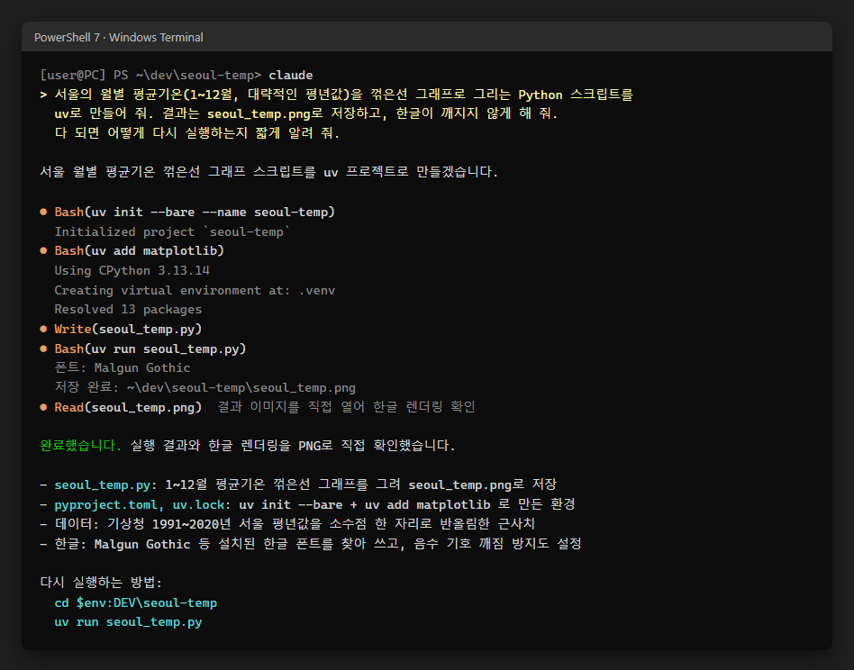
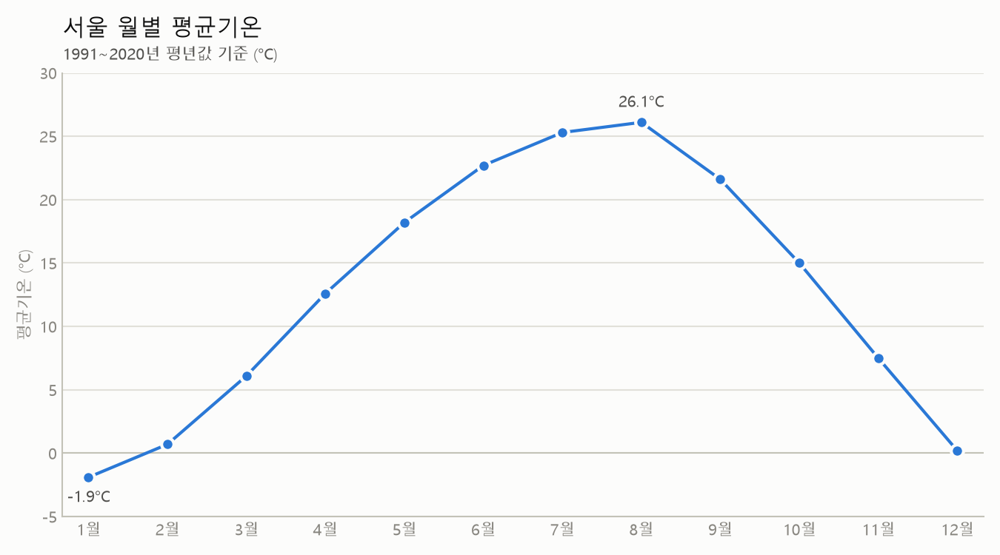

# Gem Setting — a multi-agent dev cheat kit, cut for Boseok

(Built on dev-starter.)

A Windows dev machine setup in one folder, for one PC: the core apps, a PowerShell profile,
rules for coding agents (Claude Code, Codex, Gemini CLI, OpenCode), and a git hook that keeps AI
credit lines out of commit messages.

Korean beginner guide: [START-HERE.ko.md](START-HERE.ko.md). A prompt to paste into your own AI
assistant so it can walk you through: [ASK-YOUR-AI.ko.md](ASK-YOUR-AI.ko.md).

## Quickstart

1. Extract the zip anywhere (for example `Downloads\gem-setting`).
2. Double-click `START.cmd`. If Windows asks "Do you want to run this file?", choose Run.
3. Answer two questions (your name and email for git; Enter skips either), and approve the
   Windows permission prompts the installers show.
4. Read the "Next steps" it prints at the end.

The same from a terminal:

```powershell
cd "$HOME\Downloads\gem-setting"
.\START.cmd
```

Running it again is safe: every step checks before it writes, so a second run changes nothing,
and a step that failed is retried. A rerun from any shell, even one opened before the first run,
reads the saved `DEV`, language and overlay, so it keeps them unless a parameter or the overlay's
`config.json` says otherwise (`START.cmd` passes `-Language Korean` unless you give `-Language`).

## What it looks like

After setup, open a terminal in your projects folder and ask an agent for something small:

> 서울의 월별 평균기온을 꺾은선 그래프로 그리는 Python 스크립트를 uv로 만들어 줘. 결과는 seoul_temp.png로 저장하고, 한글이 깨지지 않게 해 줘.





The agent follows the rules this kit installs: Korean replies, uv for Python, and it runs and checks
its own result before it says it is done. (Session condensed from a real run; paths shortened.)

## What it does

`START.cmd` runs `bootstrap.ps1` with the Windows PowerShell that ships with Windows (execution
policy bypassed for that one process). `bootstrap.ps1` removes the download mark from the kit's
files, installs PowerShell 7 with winget if it is missing, and runs `setup.ps1 -Apps -Language Korean`
under PowerShell 7.

The projects folder is `%DEV%` (`$env:DEV` in PowerShell): `%USERPROFILE%\dev` by default, or
whatever `-Dev` or an overlay's `dev` sets. Boseok's is `C:\Dev`.

| Step | When | Result |
|---|---|---|
| DEV | always | creates the projects folder and saves it as user variable `DEV` |
| uv Python preference | always | user variable `UV_PYTHON_PREFERENCE=only-managed`: uv uses only the Pythons it installed. On a PC with the Python install manager, the WindowsApps `python.exe` is the manager's alias, and uv probing it installs a runtime |
| Apps | `-Apps` (START.cmd passes it) | `winget import winget.json`: PowerShell 7, Windows Terminal, Git, GitHub CLI, VS Code, uv, Node.js LTS, plus an overlay's `winget` ids; then `uv python install 3.13 --default`, and `uv python update-shell`, which adds `%USERPROFILE%\.local\bin` (where `python` is) to the user PATH |
| Profile | always | `profile.ps1` to `$PROFILE` (UTF-8 console, `[user@host] PS path>` prompt with `#` when elevated) |
| Agent rules | always | `AGENTS.md` and a `CLAUDE.md` that imports it, in `%DEV%`; they apply to every project under it |
| Agent global rules | always | `claude-global.md`, with your name and language filled in, to `~\.claude\CLAUDE.md`, `~\.codex\AGENTS.md`, `~\.gemini\GEMINI.md`, `~\.config\opencode\AGENTS.md` |
| Claude Code | always | sets only `attribution` in `~\.claude\settings.json` (no co-author, PR or session lines); other settings are kept. A file that is not valid JSON, or not a JSON object, is left alone and reported as a failed step |
| Git identity | always | asks for `user.name` and `user.email` when they are not set; `-GitName`/`-GitEmail` (or the overlay's `git`) set them without asking |
| Git hooks | always | `commit-msg`, `pre-push` and forwarding copies of `forward-hook` in `~\.config\git\hooks`, set as global `core.hooksPath` |
| Windows Terminal | always | `terminal\settings.json` (starts in `%DEV%`, Cascadia Mono, dark scheme) |
| CLI tools | `-Tools` (off by default) | `tools.ps1`: the optional tools in `tools.json` |

A file that already exists and differs is backed up next to it before it is replaced. The first
backup is `<name>.bak` and is never replaced, so for a file that existed before the kit it holds
your original; each later replacement keeps the version it replaces as
`<name>.<yyyyMMdd-HHmmss>.bak`. A file the kit created has no `.bak` until the kit changes it
again, and then its `.bak` holds the kit's first version. `~\.gitconfig` is changed key by key
with `git config` and gets no backup; it may hold settings from before the kit (on Boseok's PC,
GitHub CLI's credential helpers), so it is undone key by key, never deleted (see Undo).

A failed `winget`, `uv`, `git` or `tools.ps1` run, a failing overlay hook, and a Claude Code
`settings.json` that cannot be updated do not stop the run: the other steps still run, and the end
of the output lists each failed step with the command to retry, then exits with code 1. Any other
error stops the run where it happens, with PowerShell's error message and no summary; fix the
cause and run it again.

`setup.ps1` parameters: `-Apps`, `-Tools`, `-Dev <path>`, `-GitName <name>`, `-GitEmail <email>`,
`-Language <name>` (default English; START.cmd passes Korean), `-Overlay <dir>`. Arguments given to
`START.cmd` are passed on, for example `.\START.cmd -Dev D:\code -Language English`.
A misspelled parameter or a stray word stops `setup.ps1` before its first step, with "A parameter
cannot be found that matches parameter name" or "A positional parameter cannot be found that
accepts argument" (in Korean on a Korean Windows); a stray word is usually the second half of a
name with a space, so quote it: `-GitName "Boseok Kang"`.
`bootstrap.ps1` refuses an argument that contains a double quote: typed in cmd or Windows
PowerShell 5.1, `-Dev "C:\My Dev\"` reaches it with the backslash escaping the closing quote, and
the arguments after it are split wrongly. End a folder without a backslash: `-Dev "C:\My Dev"`.

## The commit-msg hook

Claude Code's `attribution` setting only stops the lines it adds itself. An agent can still type
`Co-Authored-By: Claude ...` into a message. `commit-msg` removes, from every commit in every
repository (except one made with `git commit --no-verify`, which skips the hook):

- `Co-authored-by:` lines with an AI tool's address: `@anthropic.com`, `@openai.com`, Copilot's
  `users.noreply.github.com` address, `@cursor.com`, `@opencode.ai`, and those of Devin, Gemini
  Code Assist, Jules, Aider, Codeium, Windsurf and Tabnine
- `Co-authored-by:` lines that give a tool name (Claude, Copilot, Cursor, Codex, ChatGPT, Gemini,
  Devin, Aider, Codeium, Windsurf, Tabnine, Jules, OpenCode) and no address
- `Claude-Session:` lines
- lines that start with "Generated with" or "Generated by" and a tool name (Claude, Copilot,
  Cursor, Codex, ChatGPT, Gemini, Aider, OpenCode), with or without an emoji in front

Human co-authors with their address stay, even one named Cursor Kim or Jean-Claude Roy, and so
does an ordinary line such as "Fix duplicate rows generated by the DB cursor". Then it runs the
repository's own `commit-msg` hook, if there is one.

A global `core.hooksPath` hides each repository's `.git\hooks`, so the other hook names are
copies of `forward-hook`, which runs the repository's own hook of the same name when there is one.
They look for it in the common git directory, so repository hooks also run in linked worktrees.
Forwarded: applypatch-msg, pre-applypatch, post-applypatch, pre-commit, pre-merge-commit,
prepare-commit-msg, post-commit, pre-rebase, post-checkout, post-merge, post-rewrite, pre-auto-gc,
sendemail-validate, and the receive hooks pre-receive, update, post-receive, post-update and
proc-receive (for a repository on this PC that others push to). Left out: reference-transaction
and post-index-change, which would start `sh` on every ref update and index write, and
push-to-checkout, whose presence alone makes git skip its own `updateInstead` checkout.

`pre-push` first runs the lint that CI runs, when the repository's `.github/workflows/lint.yml` pins a
ruff version (`ruff@X.Y.Z`) and uv is installed: that ruff version, with the commands the file
runs (`check`, `format --check`, or both), on the working tree, so uncommitted changes count too.
`LOCAL_CI_TESTS=1` adds `uv run pytest` in a repository with `pyproject.toml` and a `tests` folder;
`SKIP_LOCAL_CI=1` skips both. Then, in a repository with Git LFS files, it runs `git lfs pre-push`
so the LFS objects are uploaded (unless the repository's own `pre-push` already does), and finally
the repository's own `pre-push` with the same refs. `SKIP_LOCAL_CI=1` does not skip the LFS upload;
`git push --no-verify` skips the whole hook, the LFS upload included.

Older copies of the kit did not upload LFS objects, so an LFS repository pushed with one may be
missing them on the server, and later pushes do not fill them in. Run this once in such a repository:

```powershell
git lfs push --all origin
```

`git lfs install` says "Hook already exists: pre-push" and exits with an error, because the global
hooks folder already has a `pre-push`. That is expected and harmless: Git for Windows already sets
up the LFS filters in its system config, and LFS pushes work through the kit's `pre-push`.
`git lfs install --skip-repo` sets the filters without touching hooks or printing that message.
Do not take its advice to run `git lfs update --force`: that replaces the kit's hooks in
`~\.config\git\hooks` with LFS's own. If it happened, run `setup.ps1` again to put them back.

## Customizing the agent rules

- `AGENTS.md`: rules for every project under `DEV`. Edit it and run `setup.ps1` again.
- `claude-global.md`: your personal rules for every agent. `<YOUR_NAME>` is filled from the
  overlay's `name`, else git `user.name`, else your Windows user name, and `<LANGUAGE>` from
  `-Language` or the overlay's `language` (saved as user variable `AGENT_LANGUAGE`). Replace
  either placeholder with fixed text if you prefer, add or delete lines, and run `setup.ps1` again.
- A repository's own `AGENTS.md` or `CLAUDE.md` adds to these for that repository.

## Extras

`office-view.ps1` and `tools.ps1` run in PowerShell 7 only.

- `extras\office-view.ps1`: keeps a file that a build writes apart from the copy open in Office.
  `publish <work.pptx> <view.pptx>` copies to the view file, or to `<view>_view2.pptx` while the
  view file is open; `render <deck.pptx> <outdir>` exports slides as PNG; `pdf <deck.pptx> <out.pdf>`
  prints through PowerPoint and trims the page to the slide (`office-view-crop.py`, run with uv).
  Needs PowerPoint for `render` and `pdf`.
- Optional CLI tools (`.\tools.ps1`, or `setup.ps1 -Tools`): codigest (`cdg`) and deai. `-DryRun`
  shows what would run, `-Update` updates, `-Only a,b` picks. More tools (a gh extension, a release
  `install.ps1`) go in an overlay's `config.json` `tools` list; the source repository's
  `examples\overlay` adds hanfix, gh-garden and clippath that way.
- More apps you might want: `winget install --id <id> -e` with Rustlang.Rustup, Kitware.CMake,
  Ninja-build.Ninja, prefix-dev.pixi, BurntSushi.ripgrep.MSVC, Helix.Helix, voidtools.Everything,
  M2Team.NanaZip, DigitalScholar.Zotero.

## Undo

Run these in PowerShell 7, picking the parts you need. Restore a file that existed before the kit
from its `.bak`, for example the profile:

```powershell
Move-Item -Force "$PROFILE.bak" $PROFILE
```

Delete a file the kit created, with its `.bak` files, instead of restoring it. Open a `.bak` before
restoring it: older copies of the kit, including the one first run on Boseok's PC, replaced
`<name>.bak` on every change, so after two runs it may hold a version the kit wrote.

The git hooks:

```powershell
git config --global --unset core.hooksPath
Remove-Item -Recurse "$HOME\.config\git\hooks"
```

The git identity, only if the kit set it (you typed it at its question, or `-GitName`/`-GitEmail`
or the overlay's `config.json` gave it); a name and email you had before stay:

```powershell
git config --global --unset user.name
git config --global --unset user.email
```

The Python that uv installed, before uninstalling uv itself and while `UV_PYTHON_PREFERENCE` is
still set:

```powershell
uv python uninstall 3.13
```

The user variables:

```powershell
[Environment]::SetEnvironmentVariable('DEV', $null, 'User')
[Environment]::SetEnvironmentVariable('AGENT_LANGUAGE', $null, 'User')
[Environment]::SetEnvironmentVariable('UV_PYTHON_PREFERENCE', $null, 'User')
[Environment]::SetEnvironmentVariable('DEVSTARTER_OVERLAY', $null, 'User')
```

The user PATH entry `%USERPROFILE%\.local\bin`: open "Edit environment variables for your
account", select `Path` under the user variables, Edit, delete the `.local\bin` line, OK, OK. The
Claude Code CLI (`claude`) and uv tools also live in that folder, so keep the entry if you still
use them.

```powershell
rundll32 sysdm.cpl,EditEnvironmentVariables
```

Apps, by the ids in `winget.json`:

```powershell
winget uninstall --id astral-sh.uv -e
```

winget cannot tell whether the kit installed an app or it was there before (on Boseok's PC, Git and
GitHub CLI were); uninstall only the apps the kit added.

These steps cover what the kit itself writes. An overlay's `setup.d` hooks write their own files;
Boseok's `gem-overlay` lists them in its `README.md` (the Claude Code CLI, `~\.claude\skills`,
and `Documents\PowerShell\profile.ps1`).

## Left out on purpose

This kit is for one PC used by one person. It does not set up SSH, a VPN between machines, a
phone, remote agents, several agent accounts, or syncing between PCs. To add them later, keep
them out of the core scripts: put the settings in an overlay (below), so this folder stays the
same on every machine. A second PC is then the same kit plus its own overlay; SSH keys, VPN
sign-in and account logins stay manual steps in their own tools, never files in the kit.

## Moving to another PC

Boseok's own settings (git identity, `DEV`, language, extra apps, agent rules, Claude Code skills)
are in his private overlay repository, `gem-overlay`. To rebuild this workstation on another PC or
in the cloud from GitHub, follow `MIGRATE.ko.md` in that repository (`%DEV%\gem-overlay\MIGRATE.ko.md`
on this PC). Sign-ins (GitHub, Claude) are done again by hand on the new machine.

## Tests

The test suite (`tests\run.ps1`) and `build.ps1`, which builds the zip, are in the source
repository only; this copy has neither. `setup.ps1` keeps the switch they use: with
`DEVSTARTER_SANDBOX=<dir>`, every user-level write (profile, home files, git config, user
variables, terminal settings) goes under `<dir>` and saved user variables are ignored. `-Apps` and
`-Tools` still install for real, and a `-Dev` or `-Overlay` you pass still points outside the
sandbox, so try it without them, from this folder:

```powershell
$env:DEVSTARTER_SANDBOX = "$env:TEMP\gem-sandbox"
pwsh -NoProfile -File .\setup.ps1 -GitName "Test User" -GitEmail test@example.com
Remove-Item Env:DEVSTARTER_SANDBOX
```

## Extending with an overlay (advanced)

An overlay is a folder kept outside this kit (a private repository, say) that adds personal
settings without changing the kit. Point setup at it once with `.\setup.ps1 -Overlay <dir>`
(saved as user variable `DEVSTARTER_OVERLAY`, which later runs read from any shell). Without one,
the kit works on its own. It may hold:

```
config.json      identity, DEV, language, extra winget ids, extra tools
rules\*.md       appended in name order to the generated global agent rules
setup.d\*.ps1    run in name order after the kit's own steps, each in its own pwsh
```

```json
{
  "git": { "name": "Your Name", "email": "your email" },
  "name": "Name used in the agent rules",
  "dev": "%SystemDrive%\\Dev",
  "language": "English",
  "winget": ["voidtools.Everything"],
  "tools": [ { "Name": "my-tool", "Kind": "uv", "Command": "my-tool", "Package": "my-tool" } ]
}
```

Every key is optional; a `setup.ps1` parameter wins over `config.json`. Environment variables in
`dev` are expanded. A `tools` entry uses the fields described at the top of `tools.ps1`, and
replaces a `tools.json` entry of the same name. Hooks see `DEVSTARTER_ROOT` (this kit),
`DEVSTARTER_OVERLAY` and `DEV`; a hook that exits nonzero is listed in the summary and the next one
still runs. The source repository has a worked example in `examples\overlay`.

---

Original work by NaNIsaac. You may share or publish it; please keep this credit.
